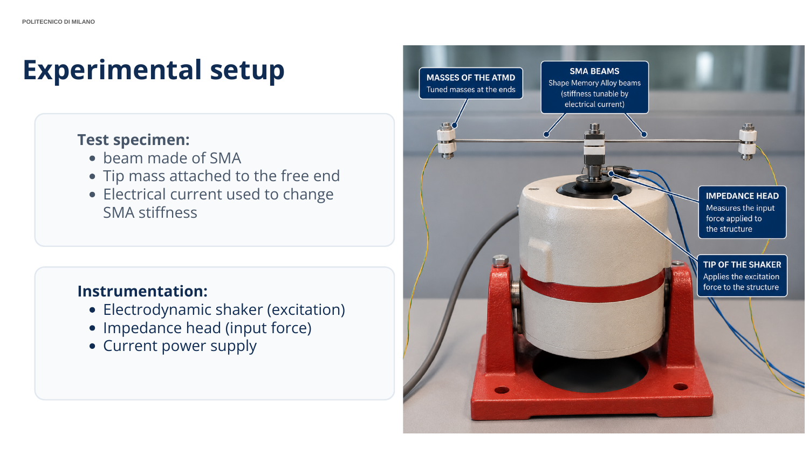
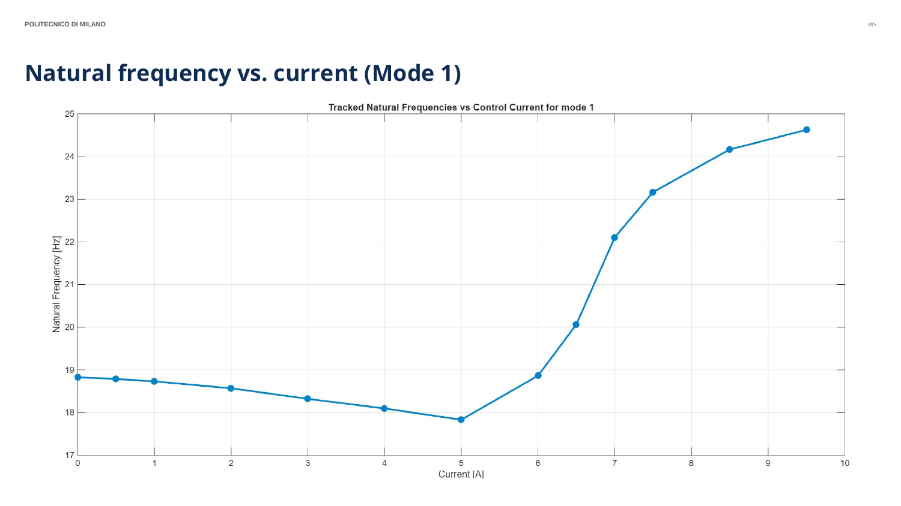
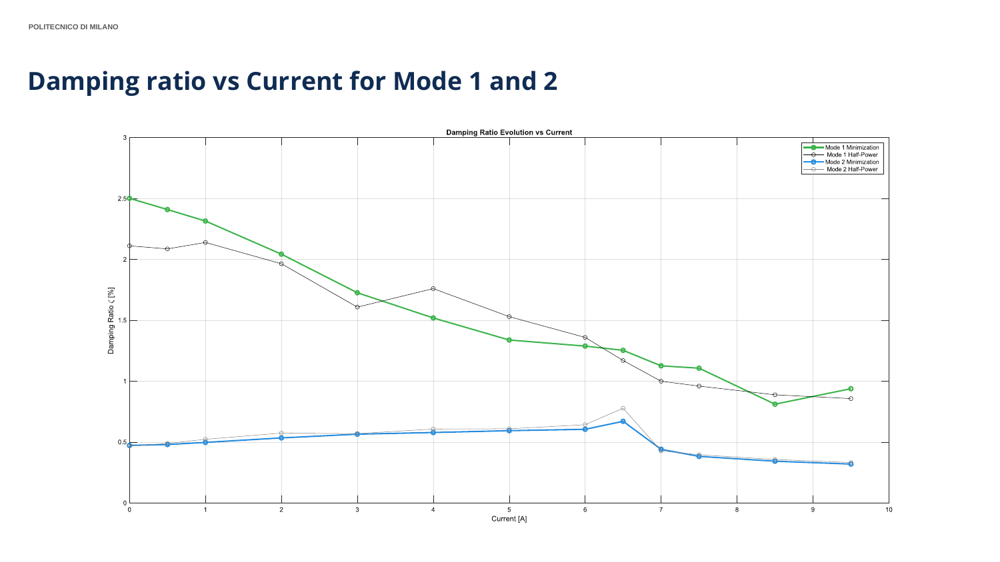

# Adaptive Tuned Mass Damper

**Experimental modal identification and control modelling of a shape memory alloy vibration absorber.**

An engineering course project at Politecnico di Milano, connecting laboratory measurements, MATLAB signal processing, modal parameter identification, and Simulink controller development. Electrical heating changes the SMA beam stiffness, allowing its resonant frequencies to be tuned.



## Objectives

- Characterize the first two vibration modes over 13 electrical current levels from 0 to 9.5 A.
- Estimate natural frequencies and damping ratios from measured acceleration and force.
- Evaluate local single degree of freedom (SDOF) fits and compare experimental behaviour with an analytical model.
- Develop inverse frequency-to-current mappings and explore feedforward and hybrid control strategies.

## Methodology

1. **Acquire and calibrate:** broadband random excitation, 2000 Hz sampling, acceleration and force channels; voltage sensitivities of 0.0102 V/(m/s^2) and 0.0224 V/N are applied in the code.
2. **Estimate spectra:** 10 s Hann windows with 60% overlap and spectral averaging. The script processes 10-500 Hz; the report describes an excitation range of 10-400 Hz.
3. **Construct the FRF:** acceleration is the input and force is the output for the apparent-mass H1 estimate, `H = G_AF / G_AA`. Coherence is computed from the same averaged spectra.
4. **Correct and transform:** the implementation adds 0.160 kg to the complex apparent mass for its clamp correction, then computes dynamic stiffness as `G_SY = -omega^2 H`. The report describes subtraction of the clamp contribution; the physical sign convention needs reconciliation before independent reuse.
5. **Identify modes:** peak picking and half-power bandwidth provide initial comparisons. Bounded `lsqnonlin` fits a six-parameter complex SDOF model within +/-10% of each detected peak: natural frequency, damping, complex residue, and complex constant residual.
6. **Assess local fits:** reconstruct the FRFs; compare complex FRF vectors using a normalized correlation metric labelled MAC in the original script; inspect Nyquist circle fits. This is FRF-vector agreement, not a measured mode-shape MAC.
7. **Develop control mappings:** fit piecewise inverse polynomials from identified frequencies to current. The supplied Simulink model contains embedded thermal-observer, phase-to-frequency, target-temperature, and gain-scheduled feedforward/feedback functions.

## Results and evidence

The values below are taken from the supplied presentation, not independently regenerated results.

| Quantity | Reported result | Evidence |
|---|---|---|
| Current levels | 13 levels, 0-9.5 A | Main script and selected data |
| First-mode frequency at 0 A | 18.8 Hz experimental; 20.1 Hz analytical | Report p. 29 |
| Second-mode frequency at 0 A | 259.3 Hz experimental; 308.3 Hz analytical | Report p. 30 |
| At 6 A | Mode 1: 18.9 Hz; mode 2: 261.7 Hz, experimental | Report pp. 29-30 |
| Nyquist circle-fit NFQ | Mode 1: 0.9898-0.9985; mode 2: 0.9954-0.9994 | Full table, report p. 26 |

The reported first-mode curve shows a frequency decrease before the transition and an increase at higher currents. The analytical model overpredicts the reported resonances, particularly for mode 2. This discrepancy motivates better geometric measurements, boundary-condition characterization, and treatment of nonlinear behaviour.





Controller material demonstrates a modelling and simulation study. It does not establish closed-loop hardware validation, vibration-reduction performance, or a measured physical response time. Fast current-command calculation does not eliminate SMA thermal inertia.

## Repository structure

```text
adaptive-tuned-mass-damper/
|-- README.md
|-- .gitignore
|-- matlab/
|   |-- Experimental_project_latest.m
|   |-- autocross.m
|   |-- plotNyquistCircle.m
|   |-- circleFit.m
|   |-- controller.slx
|   `-- Selected_data/          # Only the 13 files loaded by the main script
|-- assets/                    # Selected original presentation pages
|-- results/
|   `-- reported-circle-fit.csv
`-- docs/
    |-- project-report.pdf
    `-- REPRODUCIBILITY.md
```

## Run the analysis

Requirements: MATLAB, Signal Processing Toolbox (`hann`), and Optimization Toolbox (`lsqnonlin`, `optimoptions`). Simulink is needed to open the controller model, which was saved in R2025b. The analysis was not successfully rerun during portfolio preparation; see [reproducibility notes](docs/REPRODUCIBILITY.md).

From the repository root in MATLAB:

```matlab
cd matlab
Experimental_project_latest
```

The script clears the workspace, creates many figures, displays modal and FRF-correlation tables, and leaves fitted controller coefficients in the base workspace. Then open the controller study:

```matlab
open_system('controller.slx')
```

Opening the model does not verify a simulation. Review its settings and workspace dependencies before running it. No new turnkey simulation claim is made here.

## Limitations

- Heating experiments and small-amplitude, locally linear modal fits do not characterize the complete SMA hysteresis cycle.
- Double peaks, mode coupling, and phase-transition nonlinearities limit isolated SDOF interpretations. Near-circular Nyquist data support a local approximation rather than proving proportional damping.
- Beam length and tip-mass inertia were approximated in the analytical comparison; the analytical implementation itself is not included in the supplied archive.
- Clamp-correction sign, calibration provenance, measurement uncertainty, and repeatability require further checking.
- Only records actually loaded by the script are included. Unused raw repeats remain in the original archive; the merged-record generation procedure is not supplied.
- The unused LSCE prototypes are excluded and are not presented as validated global modal-identification code.
- A hardware feedback experiment and measured vibration attenuation are not established by the provided material.

## Technologies and engineering skills

MATLAB, Simulink, experimental dynamics, vibration testing, FFT-based spectral analysis, FRF estimation, coherence, nonlinear least squares, modal identification, SMA actuation, inverse mapping, and control modelling.

## Documentation and attribution

See the [original presentation](docs/project-report.pdf) and [reproducibility review](docs/REPRODUCIBILITY.md). All included source code and data are copied without modification. Visuals are rendered from the original presentation and are not newly measured results. Original authorship and third-party rights remain applicable; no open-source licence has been assigned in this draft.
